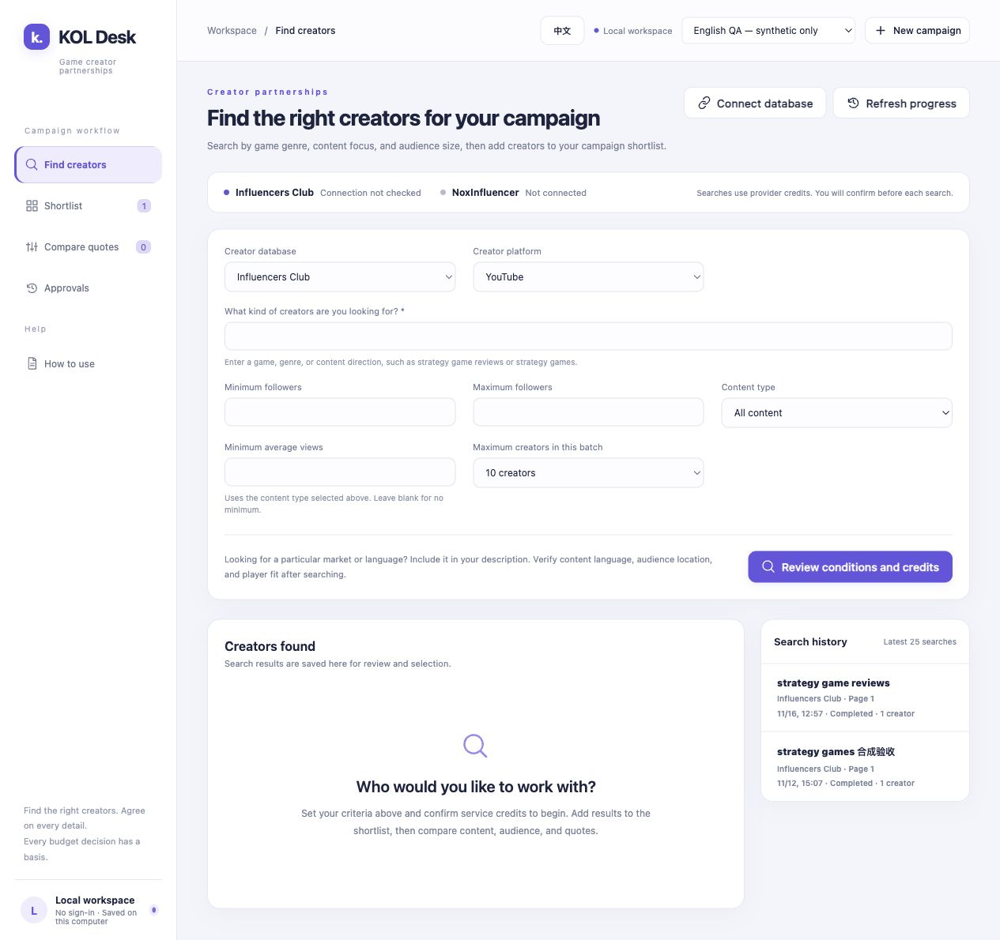

# KOL Desk

**A bilingual workspace for game creator partnerships: find creators, build a shortlist, compare complete quotes, and record approval decisions.**

[简体中文](README.zh-CN.md) · [Validation](docs/VALIDATION.md) · [Contributing](CONTRIBUTING.md)

KOL Desk runs on your computer with Python and SQLite. Open it directly without signing in, or enable optional team accounts. The interface is written for campaign managers and business development teams. It requires no Python packages, frontend build framework, or language-model API.



*Screenshot from an isolated synthetic QA workspace; it does not show live provider results.*

## Start

Requires **Python 3.9 or later**. Download or clone this repository, then:

```sh
python3 launch.py
```

- **macOS:** double-click `start.command` or `启动工作台.command`.
- **Windows:** install Python, then double-click `start.bat` (not yet tested on a Windows desktop).
- **Linux:** run `python3 launch.py` in a terminal.

The launcher opens [http://127.0.0.1:8765](http://127.0.0.1:8765). Keep its terminal window open. Reopening the launcher detects an existing KOL Desk instance instead of starting another copy. After restarting your computer, launch the app again. Closing a browser tab does not stop the server; closing its terminal does.

Use the **English / 中文** button to switch languages. The choice is remembered in this browser. Direct entry: `http://127.0.0.1:8765/?lang=en` or `?lang=zh`. Language changes do not translate or overwrite campaign names, creator information, evidence, or team notes. Unsaved form changes require confirmation before switching.

Advanced startup:

```sh
python3 server.py --open-browser
python3 server.py --require-login --open-browser
python3 server.py --port 8767 --data-dir ./another-workspace
```

The last command uses a separate workspace. The default database is relative to the application directory, not your terminal directory.

## The business workflow

1. **Create a campaign.** Record the game, target players, market, language, objective, content format, currency, and full budget.
2. **Find creators.** Connect a provider account or add creators manually. A search runs only after you confirm its conditions and credits.
3. **Build a shortlist.** Verify representative content, target audience, availability, and exclusivity. Search ranking alone is not a fit assessment.
4. **Compare quotes.** Include creator fees, licensing, exclusivity, production/localization, taxes/agency/payment costs, and the maximum bonus.
5. **Approve a partnership.** Record the reason and the information reviewed. Changed quotes or requirements trigger another review.
6. **Export a handover.** Download a creator CSV or a decision report. English UI exports use English report labels; entered business information keeps its original language.

The optional sample campaign contains **synthetic creators, quotes, audience data, forecasts, and example.com links**. It is never used to fill real search results.

## Creator search

| Provider | Platforms in this version | Account setup |
| --- | --- | --- |
| Influencers Club | YouTube, TikTok, Instagram, Twitch | [Provider dashboard](https://dashboard.influencers.club) |
| NoxInfluencer | YouTube, TikTok, Instagram | [Provider dashboard](https://cn.noxinfluencer.com/skills/dashboard) |

Open **Connect database**, enter the provider access key (called **API Key** in the provider dashboard), save, then check the connection. This checks the account endpoint without searching for creators. You need a provider account with suitable API access and credits. Open-source connectors do not include a free creator database.

Search by topic, follower range, average-view threshold, and platform. YouTube can distinguish long videos from Shorts. A search requests **one page of up to 20 creators**. Each additional page requires a new confirmation. Nox pagination retains its provider cursor and original filters.

- **Pricing:** Club uses a documentation estimate of 0.01 credit per creator returned; actual charges are controlled by the provider. Nox reads the account search price and checks it again before execution. Unknown batch pricing is rejected. Credits are provider units, not money or creator fees.
- **Saved results:** revisiting a result or refreshing progress does not repeat the search. Duplicate execution of the same completed request returns its saved result.
- **Failures:** no automatic paid retry. A timeout or process interruption may occur after the provider charges; check provider usage before starting another search.
- **Evidence:** results preserve the provider, query, timestamp, missing fields, and a credential-sanitized response archive. Imports deduplicate by stable source identity and do not infer verified audiences, fit, or quotes.
- **Limits:** creator location is not audience location. Market/language text is a search clue, not a hard audience filter. Club format filters indicate the presence of that format, not primary content type. Nox may mask names and return opaque IDs; these are not fabricated into public accounts or URLs.
- **No outreach:** the app does not automatically unlock profiles, fetch contacts, send invitations, purchase campaigns, or make payments.

**Integration status:** adapter contracts were reviewed against the supplied provider repositories and Nox CLI 0.5.12. Automated tests use synthetic responses. No live provider account, real search results, actual billing, or result quality has been validated for this release.

Keys entered in the UI last for the current server process only. They are not written to the database, source repository, or exports. Alternatively, set `INFLUENCERS_CLUB_API_KEY` or `NOXINFLUENCER_API_KEY` in the process environment before startup. Do not put keys in campaign notes, search descriptions, screenshots, or issues. Clearing a key does not remove saved results; environment-provided keys load again at the next start.

## Business rules

- Blank fees mean **unknown**; `0` means a confirmed zero fee.
- The maximum cost includes the bonus cap. Mixed currencies are not added together; no automatic exchange rates are assumed.
- Required audience evidence, content fit, rights, payment terms, availability, and exclusivity must be complete before approval.
- Approval checks the **whole selected budget**, not only one creator. Approved creators remain part of the budget until approval is revoked and the selection is changed.
- Edits preserve prior approval information and require a new review. Concurrent stale edits are rejected rather than overwriting newer work.
- Forecast cost per view/action requires a complete cost and an entered forecast rationale. It is not observed performance or a guarantee.
- Internal approval does not mean creator acceptance or a signed contract.

## Lists and exports

Download the blank template, complete it in Excel or another spreadsheet app, and save as **CSV UTF-8**. Direct `.xlsx` upload is not supported. Import limit: 500 creators / 1.5 MB.

Required headers: `name`, `platform`; each row must have `account_id` or `profile_url`. Optional headers are listed in the template. Platform values: `YouTube`, `TikTok`, `Twitch`, `Instagram`, `Bilibili`, `Other`. Content format accepts `Long video`, `Short video`, `Livestream`, or `Image/text post`; Chinese equivalents are also accepted. Use your own market/language names consistently across campaigns and creators.

Preview errors before importing. Invalid batches save nothing; existing platform identities are skipped. CSV downloads protect against spreadsheet formula injection. Creator CSVs are summaries, **not full workspace backups**.

## Data and team use

Saved data is in `data/workspace.sqlite3`. Stop the server and copy the **entire `data` directory** to back it up. Stop the server before restoring a backup. Preserve your `data` directory when updating source code. `--data-dir` and `KOL_DATA_DIR` can choose another location.

The default no-sign-in mode records actions as **Local workspace** and does not distinguish individuals. Optional `--require-login` supports administrators, campaign managers, and reviewers; all accounts share all campaigns. Only administrators connect provider accounts; administrators and campaign managers may search. Reviewers can approve without editing creator information or spending search credits.

This is a **local internal-use application**, not a hosted multi-user service. It listens on loopback only and has no project-level access isolation, password recovery UI, or encrypted database. Do not expose this port publicly. A GitHub repository hosts the source code; it does not host your workspace or business data.

## Develop and verify

```sh
PYTHONDONTWRITEBYTECODE=1 python3 -m unittest discover -s tests -v
python3 scripts/build_locales.py --check
node --check static/app.js
node --check static/discovery.js
node --check static/en/app.js
node --check static/en/discovery.js
```

Python tests use temporary databases, localhost ports, and synthetic provider responses. Node is only needed for JavaScript syntax checks, not for running the app. GitHub Actions runs Python tests and locale/JavaScript checks.

The Chinese JavaScript files are the shared UI source. `locales/en.json` is a reviewed catalog; `python3 scripts/build_locales.py` regenerates English assets. Generated English files are committed so users need no build step. API localization applies only to defined system fields, not arbitrary user text. Canonical business values remain compatible with existing Chinese workspaces.

| Path | Purpose |
| --- | --- |
| `server.py` | HTTP, SQLite, sessions, business rules, import/export |
| `discovery.py` | Provider search adapters and ephemeral access keys |
| `i18n.py`, `reports.py` | Field-scoped localization and English reports |
| `static/`, `locales/` | Bilingual web interface |
| `launch.py`, `start.*` | Local startup and reopen helpers |
| `tests/`, `.github/workflows/` | Regression checks and CI |

## License and acknowledgments

Original application code is MIT licensed; see [LICENSE](LICENSE). Provider service terms, access rights, and charges apply separately. See [THIRD_PARTY_NOTICES.md](THIRD_PARTY_NOTICES.md) for the Influencers Club and Nox references and their distinct license scopes. No Nox proprietary CLI or plugin code is bundled.
